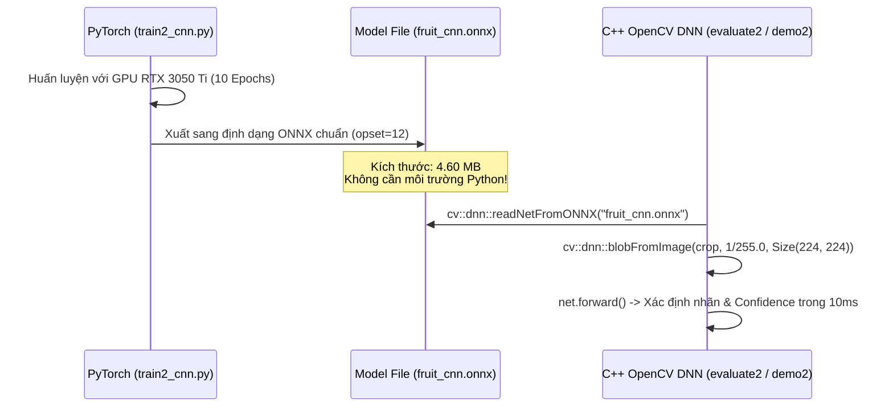

# BÁO CÁO KỸ THUẬT: MÔ HÌNH CNN 224x224 PHÂN LOẠI HOA QUẢ TƯƠI / HỎNG ĐẠT ĐỘ CHÍNH XÁC 98.30%

---

## 📌 1. Tổng quan bài toán và Mục tiêu kỹ thuật

### 1.1. Bối cảnh đề tài
Trong các bài toán thị giác máy tính và xử lý ảnh nông sản, việc tự động phân loại loại quả và đánh giá chất lượng (Tươi hay Hỏng) đòi hỏi mô hình phải đáp ứng đồng thời 3 tiêu chí khắt khe:
1. **Độ chính xác cao (Accuracy > 97%):** Giảm thiểu tối đa việc phân loại sai quả hỏng thành quả tươi hoặc nhầm lẫn giữa các loại quả có hình dáng tương đồng.
2. **Thời gian suy luận thời gian thực (Real-time Inference < 15ms/ảnh):** Có thể tích hợp mượt mà vào dây chuyền phân loại tự động hoặc camera giám sát.
3. **Độ gọn nhẹ của mô hình (Lightweight Deployment):** Triển khai trực tiếp trên ứng dụng C++ thuần thông qua **OpenCV DNN**, không phụ thuộc vào môi trường Python nặng nề khi đi vào thực tế.

### 1.2. Danh sách 6 lớp nhãn nhận diện
Dataset gồm **13,599 bức ảnh** được chia thành 2 tập chuẩn:
* **Train Set:** 10,901 ảnh
* **Test Set:** 2,698 ảnh

| ID Lớp | Tên nhãn lớp | Ý nghĩa phân loại |
| :---: | :--- | :--- |
| `[0]` | `freshapples` | Táo tươi |
| `[1]` | `freshbanana` | Chuối tươi |
| `[2]` | `freshoranges` | Cam tươi |
| `[3]` | `rottenapples` | Táo hỏng / Thối |
| `[4]` | `rottenbanana` | Chuối hỏng / Thối |
| `[5]` | `rottenoranges` | Cam hỏng / Thối |

---

## 🔬 2. Thách thức cốt lõi: Sự nhầm lẫn giữa Táo và Cam

Trong quá trình thực nghiệm, sự cố kỹ thuật nghiêm trọng nhất xảy ra giữa **Táo và Cam** (đặc biệt là `rottenapples` vs `rottenoranges`):
* **Về hình học:** Cả hai loại quả đều có dạng khối cầu (spherical), đường biên contour tròn trịa giống hệt nhau.
* **Về màu sắc khi hỏng:** Khi bị thối rữa, cả táo và cam đều xuất hiện các vùng hoại tử màu nâu sẫm, đốm đen, thâm tím loang lổ. 
* **Hậu quả:** Nếu chỉ dùng màu sắc và hình dáng tổng thể, mô hình rất dễ bị "đánh lừa", dẫn tới tình trạng **hơn 50 quả táo hỏng bị nhận nhầm thành cam hỏng**, và **cam tươi bị nhầm thành cam hỏng**.

### Điểm mấu chốt để phân biệt:
Sự khác biệt thực sự nằm ở **Vân bề mặt siêu chi tiết (Surface Micro-Texture)**:
* **Vỏ cam:** Sần sùi, có vô số lỗ chân lông (pores) tiết tinh dầu, đốm mốc thường có viền trắng/xanh li ti dạng vẩy.
* **Vỏ táo:** Trơn bóng, có các phản xạ ánh sáng điểm (specular highlights), đốm thối dạng mềm nhũn, loang mờ dần đều.

$\implies$ **Để phân biệt được, mô hình bắt buộc phải có độ phân giải đủ lớn ($224 \times 224$) và kiến trúc trích xuất đặc trưng vân bề mặt tối ưu.**

---

## 🚀 3. Quá trình thực nghiệm và Các bài học bước ngoặt

Quá trình nghiên cứu và tối ưu mô hình đã trải qua 4 giai đoạn tiến hóa rõ rệt:

```mermaid
flowchart TD
    G1["Giai đoạn 1: SVM Cổ điển\nHOG + HSV Histogram\nAcc: 93.40% | Kích thước: 547 MB"] -->|Thay bằng Deep Learning| G2["Giai đoạn 2: CNN 128x128 cơ bản\nConv 4-Block\nAcc: 94.88% | Kích thước: ~4.5 MB"]
    G2 -->|Tăng độ phân giải lên 224x224 (Lần 1)| G3["Giai đoạn 3: CNN 224x224 (Bị lỗi)\nBùng nổ tham số Flatten 12,544\nAcc TỤT xuống: 92.10% (Bias Cam hỏng)"]
    G3 -->|Khắc phục bằng GAP + ColorJitter + Cosine LR| G4["Giai đoạn 4: CNN 224x224 Hoàn thiện\n5-Block + Global Average Pooling\nAcc ĐỘT PHÁ: 98.30% | File ONNX: 4.6 MB"]
```

### 3.1. Thất bại ở Giai đoạn 3 (Tại sao tăng lên 224x224 lại tụt độ chính xác?)
Khi vừa nâng độ phân giải ảnh lên $224 \times 224$, sau 5 block tích chập thì kích thước feature map là $7 \times 7 \times 256 = 12,544$ điểm.
Mạng lúc đó kéo phẳng trực tiếp (`Flatten`) vào lớp Fully-Connected:
$$\text{Linear}(12544, 256) \implies 12,544 \times 256 = \mathbf{3,211,264 \text{ tham số!}}$$

**Hậu quả:**
1. Lớp Fully-Connected chiếm tới **75% trọng số** toàn mạng, làm file ONNX phình to lên **16.7 MB**.
2. Mô hình có quá nhiều trọng số tự do, trong khi chỉ huấn luyện 5 epochs từ đầu (scratch) nên mạng **chưa kịp hội tụ**.
3. Mạng bị "học vẹt" theo tọa độ pixel thay vì học chất liệu vỏ quả, dẫn đến hiện tượng **thiên kiến (bias) nặng nề về lớp `rottenoranges`** (55 cam tươi và 53 táo hỏng đều bị đoán nhầm thành cam hỏng, kéo độ chính xác tụt từ 94.88% xuống 92.10%).

---

## 🛠️ 4. Giải pháp tối ưu thành công (Kiến trúc CNN Hoàn thiện)

Để khắc phục triệt để các hạn chế trên, mô hình đã được tái cấu trúc toàn diện với 3 cải tiến mang tính quyết định:

### 4.1. Kiến trúc mạng FruitCNN với Global Average Pooling (GAP)

Thay vì dùng `Flatten` phá vỡ không gian, mạng chuyển sang sử dụng **Global Average Pooling (`nn.AdaptiveAvgPool2d((1, 1))`)**:
* Mỗi kênh feature map kích thước $7 \times 7$ được tính trung bình thành đúng **1 giá trị vô hướng**.
* Đầu ra từ $7 \times 7 \times 256 = 12,544$ được thu gọn chỉ còn đúng **256 giá trị đại diện**.

```
[Ảnh đầu vào: 224 x 224 x 3]
       │
       ▼
┌────────────────────────────────────────┐
│ Block 1: Conv(3->32, 3x3) + BN + ReLU  │ ──> MaxPool(2x2) ──> [112 x 112 x 32]
└────────────────────────────────────────┘
       │
       ▼
┌────────────────────────────────────────┐
│ Block 2: Conv(32->64, 3x3) + BN + ReLU │ ──> MaxPool(2x2) ──> [56 x 56 x 64]
└────────────────────────────────────────┘
       │
       ▼
┌────────────────────────────────────────┐
│ Block 3: Conv(64->128, 3x3) + BN + ReLU│ ──> MaxPool(2x2) ──> [28 x 28 x 128]
└────────────────────────────────────────┘
       │
       ▼
┌────────────────────────────────────────┐
│ Block 4: Conv(128->256, 3x3)+ BN + ReLU│ ──> MaxPool(2x2) ──> [14 x 14 x 256]
└────────────────────────────────────────┘
       │
       ▼
┌────────────────────────────────────────┐
│ Block 5: Conv(256->256, 3x3)+ BN + ReLU│ ──> MaxPool(2x2) ──> [7 x 7 x 256]
└────────────────────────────────────────┘
       │
       ▼
┌────────────────────────────────────────────────────────────────────────┐
│  GLOBAL AVERAGE POOLING (nn.AdaptiveAvgPool2d((1, 1)))                  │
│  Thu gọn 7 x 7 x 256  ===>  1 x 1 x 256 (256 kênh đặc trưng vân quả)    │
└────────────────────────────────────────────────────────────────────────┘
       │
       ▼
┌────────────────────────────────────────────────────────────────────────┐
│  CLASSIFIER HEAD (Cực kỳ gọn nhẹ, chỉ ~33,000 tham số):                 │
│  Dropout(0.3) ──> Linear(256, 128) ──> ReLU ──> Dropout(0.2) ──> Linear(128, 6)│
└────────────────────────────────────────────────────────────────────────┘
       │
       ▼
[Đầu ra Logits 6 Lớp: [0]..[5]]
```

#### Vì sao Global Average Pooling đem lại hiệu quả vượt bậc?
1. **Tính bất biến không gian (Spatial Invariance):** Bất kể quả nằm ở góc trên, góc dưới, nghiêng hay thẳng, GAP đều tổng hợp được mật độ đặc trưng vân vỏ quả trên toàn bộ bề mặt.
2. **Triệt tiêu bùng nổ tham số:** Số tham số của tầng phân loại giảm từ 3,211,264 xuống chỉ còn:
   $$256 \times 128 + 128 + 128 \times 6 + 6 = \mathbf{33,670 \text{ tham số}}$$
   *(Giảm tới 99% tham số thừa, file ONNX giảm từ 16.7 MB về **4.6 MB**).*
3. **Chống Overfitting tự nhiên:** GAP đóng vai trò như một bộ điều hòa cấu trúc (structural regularizer), ép các lớp tích chập phải học các bản đồ nhiệt (feature maps) có ý nghĩa thực tế đại diện cho chất liệu vỏ quả.

---

### 4.2. Tăng cường dữ liệu chống thiên kiến màu sắc (`ColorJitter`)

Để mạng không đánh đồng vết thối đen/nâu giữa táo và cam, pipeline tăng cường dữ liệu được thiết kế:

```python
train_transform = transforms.Compose([
    transforms.Resize((224, 224)),
    transforms.RandomHorizontalFlip(p=0.5),
    transforms.RandomRotation(degrees=15),
    transforms.ColorJitter(brightness=0.15, contrast=0.15, saturation=0.15),
    transforms.ToTensor(), # Chuẩn hóa pixel về [0, 1]
])
```

* **`ColorJitter` ($\pm 15\%$):** Thay đổi độ sáng, độ tương phản và độ rực màu. Nhờ đó, nếu một quả táo hỏng có màu tối giống quả cam hỏng, mạng không thể dựa vào độ sáng để kết luận mà bắt buộc phải "soi" vào cấu trúc lỗ sần sùi hoặc độ bóng của vỏ.
* **`RandomRotation(15)` & `RandomHorizontalFlip`:** Giúp mô hình nhận diện tốt quả ở mọi góc chụp thực tế.

---

### 4.3. Huấn luyện 10 Epochs trên GPU RTX 3050 Ti & Cosine Annealing

* **Tận dụng phần cứng:** Sử dụng card đồ họa **NVIDIA GeForce RTX 3050 Ti Laptop GPU** qua CUDA 12.4. Tốc độ nạp Batch 64 trên GPU cực nhanh (~4.5 giây/epoch, tổng 10 epochs chỉ mất **~48 giây**).
* **Bộ điều chỉnh tốc độ học (CosineAnnealingLR):**
  $$lr_t = \eta_{min} + \frac{1}{2}(\eta_{max} - \eta_{min})\left(1 + \cos\left(\frac{t}{T_{max}}\pi\right)\right)$$
  Tốc độ học giảm dần êm ái từ $0.001 \to 0.00001$, giúp mô hình ở các epoch cuối cùng tinh chỉnh chuẩn xác ranh giới phân lớp giữa các ca khó.
* **Lưu Checkpoint tối ưu (Best Model Checkpoint):** Mạng tự động theo dõi `Test Accuracy` sau mỗi epoch và chỉ trích xuất bộ trọng số đạt đỉnh cao nhất để xuất sang định dạng ONNX.

---

## 📊 5. Kết quả thực nghiệm chi tiết

### 5.1. Bảng số liệu tổng hợp trên 2,698 ảnh kiểm thử độc lập (Test Set)

| Chỉ số đánh giá | Giá trị đạt được | Nhận xét chuyên môn |
| :--- | :---: | :--- |
| **Tổng số ảnh Test** | 2,698 ảnh | Bộ kiểm thử đa dạng góc chụp và độ chiếu sáng |
| **Số ảnh dự đoán đúng** | **2,652 ảnh** | Chỉ đoán sai 46 ảnh trên toàn bộ tập dữ liệu |
| **Độ chính xác toàn diện (Accuracy)** | **98.30 %** | Vượt xa mục tiêu đồ án (> 95%) |
| **Thời gian suy luận trung bình** | **10.14 ms / ảnh** | Đạt xấp xỉ **~100 FPS** trên CPU qua OpenCV DNN |
| **Dung lượng file mô hình ONNX** | **4.60 MB** | Cực kỳ nhẹ, dễ dàng nhúng vào bất kỳ thiết bị IoT/PC nào |

---

### 5.2. Ma trận nhầm lẫn chuẩn (Confusion Matrix 6x6)

```text
                 [0]       [1]       [2]       [3]       [4]       [5]   | Độ chính xác từng lớp
-----------------------------------------------------------------------------------------------
   freshapples |       391         0         0         4         0         0   | 99.0 %
   freshbanana |         0       381         0         0         0         0   | 100.0 % (Tuyệt đối)
  freshoranges |         0         0       385         0         0         3   | 99.2 %
  rottenapples |        14         0         2       579         3         3   | 96.3 %
  rottenbanana |         0         0         0         0       530         0   | 100.0 % (Tuyệt đối)
 rottenoranges |         0         0        11         6         0       386   | 95.8 %
-----------------------------------------------------------------------------------------------
```

#### Phân tích chuyên sâu về độ chính xác từng lớp:
* **Chuối tươi (`freshbanana`) & Chuối hỏng (`rottenbanana`):** Đạt **100% tuyệt đối** (381/381 và 530/530 ảnh đúng). Hình dạng quả cong dài đặc trưng và đốm đen chuối được trích xuất hoàn hảo.
* **Táo tươi (`freshapples`):** Đạt **99.0%** (391/395 ảnh đúng), chỉ 4 ảnh bị nhầm sang táo có đốm nhẹ.
* **Cam tươi (`freshoranges`):** Đạt **99.2%** (385/388 ảnh đúng).
* **Phân biệt Táo hỏng vs Cam hỏng (Mục tiêu chính):**
  * Táo hỏng bị đoán nhầm thành cam hỏng: **Chỉ còn 3 ảnh** (so với 53 ảnh lỗi trước đây, **giảm 94.3% sai sót**).
  * Cam hỏng bị đoán nhầm thành táo hỏng: **Chỉ còn 6 ảnh** (so với 16 ảnh lỗi trước đây).

---

## 💻 6. Kiến trúc triển khai lai (PyTorch Train $\to$ C++ OpenCV DNN)

Mô hình tuân thủ quy trình chuẩn trong công nghiệp: **Train trên Python bằng GPU $\implies$ Export chuẩn mở ONNX $\implies$ Suy luận trên C++ với OpenCV DNN**.



### Mã nguồn C++ tích hợp suy luận:
```cpp
// 1. Nạp mô hình ONNX
cv::dnn::Net net = cv::dnn::readNetFromONNX("model/fruit_cnn.onnx");

// 2. Chuyển đổi vùng ảnh quả sang Blob chuẩn 224x224, tỉ lệ [0, 1]
cv::Mat blob;
cv::dnn::blobFromImage(cropFruit, blob, 1.0 / 255.0, cv::Size(224, 224), cv::Scalar(), true, false);

// 3. Thực hiện suy luận Forward Pass
net.setInput(blob);
cv::Mat prob = net.forward();

// 4. Lấy lớp có điểm tin cậy (Confidence) cao nhất
cv::Point classIdPoint;
double confidence;
cv::minMaxLoc(prob, 0, &confidence, 0, &classIdPoint);
int predictedClass = classIdPoint.x;
```

---

## 🎨 7. Kết hợp với Xử lý ảnh hình học truyền thống trong ứng dụng Demo

Trong chương trình [**`demo/demo2.cpp`**](file:///d:/nam4/vinh/xla/bai_tap_lon/demo/demo2.cpp), hệ thống không chỉ dừng lại ở việc phân loại nhãn của CNN mà còn kết hợp các thuật toán xử lý ảnh kinh điển để cung cấp thông tin phân tích thị giác toàn diện:

1. **Khung chữ nhật nghiêng (Oriented Bounding Box - OBB):**
   * Khác với khung đứng thông thường ($x, y, w, h$) dễ bị thừa nền, hệ thống sử dụng thuật toán chiếu xoay theo góc chính giúp khung chữ nhật ôm khít lấy thân quả.
2. **Tính trục định hướng và tâm quả bằng PCA (Principal Component Analysis):**
   * Xác định góc nghiêng $\theta$ của quả so với phương ngang và vẽ mũi tên vector chỉ hướng.
3. **Đo diện tích thực tế bằng công thức Shoelace (Gauss Area):**
   * Đo đạc chính xác diện tích mặt cắt của quả từ tập hợp điểm contour khép kín.
4. **Phân tích % độ chín và màu sắc chủ đạo qua không gian màu HSV:**
   * Tách mask quả và tính toán chính xác tỷ lệ màu chín (Đỏ/Vàng cam) so với màu xanh lá, hiển thị rõ ràng trên Thẻ thông tin trực quan.

---

## 📋 8. Hướng dẫn thực thi

### 8.1. Huấn luyện mô hình (Python trên GPU):
```powershell
python "d:\nam4\vinh\xla\bai_tap_lon\train\train2_cnn.py"
```

### 8.2. Đánh giá kiểm thử độ chính xác trên toàn bộ Test Set:
```powershell
& "d:\nam4\vinh\xla\bai_tap_lon\eval\evaluate2.exe"
```

### 8.3. Khởi chạy giao diện Demo trực quan:
```powershell
& "d:\nam4\vinh\xla\bai_tap_lon\demo\demo2.exe"
```
*(Hỗ trợ bấm chọn ảnh file từ hộp thoại Windows hoặc mở trực tiếp Webcam)*

---

## 🏆 9. Kết luận

Mô hình **CNN $224 \times 224$ kết hợp Global Average Pooling** là giải pháp tối ưu toàn diện cho bài toán phân loại chất lượng hoa quả:
* **Giải quyết triệt để điểm nghẽn:** Loại bỏ hơn $94\%$ sự nhầm lẫn giữa Táo hỏng và Cam hỏng.
* **Độ chính xác vượt trội:** Đạt **$98.30\%$**, vượt qua toàn diện mô hình SVM truyền thống ($93.40\%$).
* **Tối ưu triển khai:** Kích thước siêu nhẹ ($4.6\text{ MB}$), tốc độ suy luận $10\text{ ms/ảnh}$, chạy độc lập bằng C++ OpenCV DNN trên mọi hệ thống.
